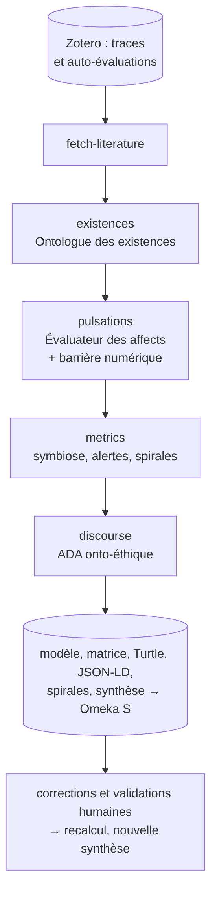

# modelisationOntoEthique

Écosystème d'agents IA pour la **modélisation onto-éthique des existences informationnelles** dans un environnement humain-numérique (Laboratoire Paragraphe, Université Paris 8).

L'application **ontoÉthique** applique le protocole de mesure des fluctuations du métamodèle onto-éthique (S. Szoniecky, « Le tournant ontologique dans les humanités numériques ») à une **activité située** :

- les **existences informationnelles** — actants humains, agents numériques, environnement documentaire — sont décrites par quatre dimensions (matérielle, conceptuelle, sociale, temporelle) ;
- chaque **pulsation** de l'activité est évaluée dans la **grille des affects** : quatre pouvoirs (discerner, raisonner, résonner, agir) notés de -100 à +100, rattachés à leur séquence de sémiose, qualifiés par les valeurs tardiennes (utilité, vérité, beauté) ;
- la **symbiose** entre humains, agents et environnement est mesurée (indice, équilibre, alertes de misère symbolique ou de cécité cognitive) et figurée par des **spirales coniques de Pappus** ;
- un **ADA onto-éthique** rédige une synthèse située, que les participants discutent après avoir **corrigé et validé** la matrice (souveraineté de l'expertise humaine, révisions tracées) ;
- le modèle est archivé dans **Omeka S** et exporté en **Turtle** et **JSON-LD** (principes FAIR).



## Démarrage rapide

```bash
npm ci
```

```bash
npm run ui:ontoethique
```

Ouvrir http://127.0.0.1:7280, renseigner les connexions (⚙ Paramètres), puis **Activité › Charger l'exemple de l'article** pour essayer sans connexion, ou choisir une collection Zotero et **Enregistrer et modéliser**. Avec Docker : `docker compose up -d --build`.

Documentation : [docs/README.md](docs/README.md) — installation, guide de l'utilisateur, documentation technique (aussi servie sur `/docs/`).

## TODO

- Enregistrer les existences et les pulsations comme items Omeka S (classes du vocabulaire `oe:`), au-delà des fichiers.
- Publier le vocabulaire `oe:` à une URI pérenne (`ontology.baseUri`).
- Comparer plusieurs évaluations d'une même activité (trajectoires successives, scénarios).
