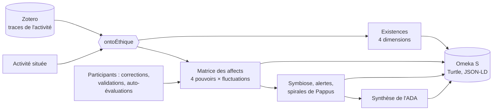

# Documentation

Écosystème d'agents IA pour la **modélisation onto-éthique des existences informationnelles** (Laboratoire Paragraphe, Université Paris 8). Les traces viennent de **Zotero**, les modèles de l'**API Albert**, l'archive est **Omeka S**.

| Application | Adresse | Rôle |
|---|---|---|
| **ontoÉthique** | http://127.0.0.1:7280 | à partir des traces d'une **activité située** : existences informationnelles (humains, agents numériques, environnement) et leurs quatre dimensions, **matrice des affects** des quatre pouvoirs (discerner, raisonner, résonner, agir), symbiose, alertes, **spirales de Pappus**, synthèse de l'ADA onto-éthique, corrections et validations humaines, export Linked Open Data |

| Document | Pour qui | Contenu |
|---|---|---|
| [Installation](installation.md) | administrateur | prérequis, installation locale et Docker, préparation d'Omeka S, vérification, dépannage |
| [Utilisateur](utilisateur.md) | chercheur, enseignant, participants | préparer les traces, lancer, corriger et valider, interpréter |
| [Technique](technique.md) | développeur | architecture, modèle onto-éthique, mesures, export LOD, configuration, API |

La version HTML de cette documentation est générée par `npm run docs` dans `docs/html/` et servie sur `/docs/` (http://127.0.0.1:7280/docs/).
