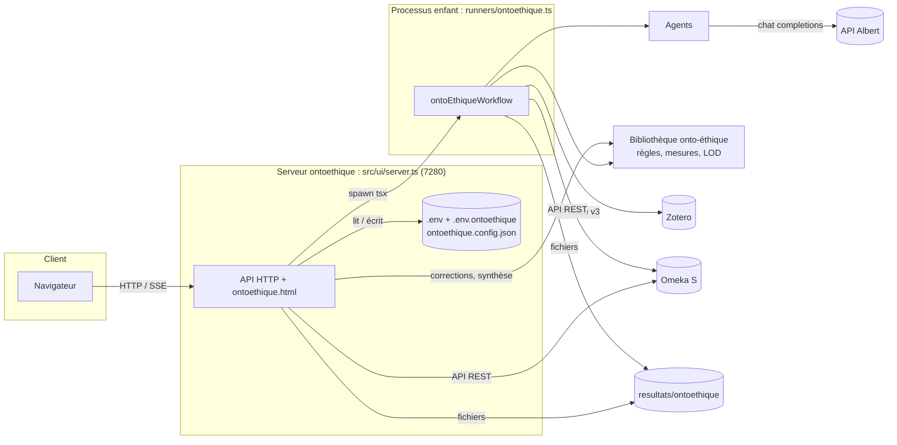
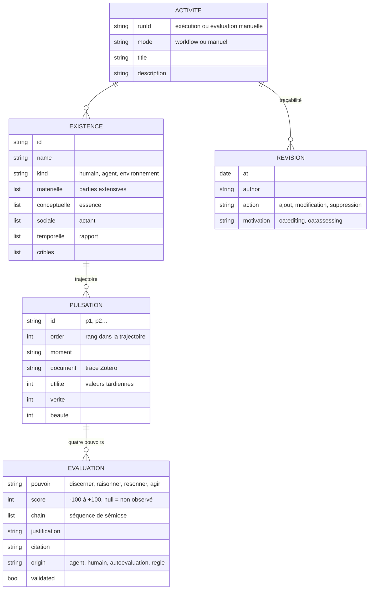
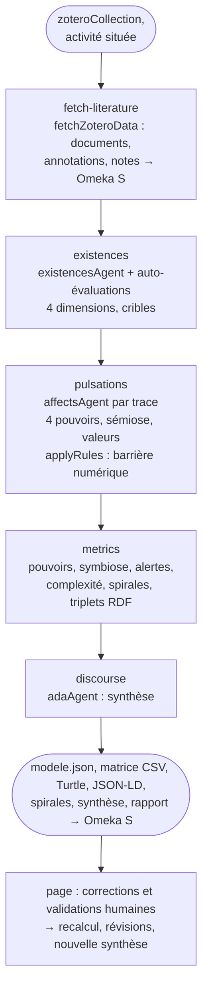

# Documentation technique

Écosystème d'agents IA pour la **modélisation onto-éthique des existences informationnelles** dans un environnement humain-numérique (Laboratoire Paragraphe, Université Paris 8). Le projet est écrit en **TypeScript**, exécuté par **tsx** sous **Node.js 22+**, et orchestré par des workflows **Mastra**. Les modèles de langage sont ceux de l'**API Albert** (compatible OpenAI), les traces viennent de **Zotero** et les résultats sont archivés dans **Omeka S**.

Le socle (connexions, comptage des tokens et coût, onglet Workflow, item de configuration Omeka S, archives, serveur) est repris de l'écosystème `ecosysteme-agents-recherche` ; chaque application y ajoute son workflow, son lanceur, sa page et son serveur :

| Application | Workflow | Lanceur | Page | Serveur | Section |
|---|---|---|---|---|---|
| ontoÉthique | `ontoEthiqueWorkflow` (`src/workflow/ontoethiqueWorkflow.ts`) | `src/runners/ontoethique.ts` | `ontoethique.html` | `ONTOETHIQUE_PORT` 7280 | 12 |

Le cadre théorique et le protocole de mesure sont ceux de l'article « Le tournant ontologique dans les humanités numériques » (S. Szoniecky) : métamodèle à quatre dimensions existentielles, quatre pouvoirs de la pulsation existentielle, grille des affects (-100 à +100), triplets de sémiose, valeurs tardiennes, spirale conique de Pappus.

## 1. Architecture



- **Interface** (`src/ui/server.ts`) : serveur `node:http` sans dépendance, lancé une fois par application, qui gère les connexions et la configuration, lance le workflow dans un **processus enfant** (configuration et connexions relues à chaque exécution), diffuse le journal en **Server-Sent Events** et sert les résultats. Les routes propres à ontoÉthique sont dans `src/ui/ontoethiqueRoutes.ts`.
- **Lanceur** (`src/runners/ontoethique.ts`) : enregistre la configuration dans Omeka S, exécute le workflow, écrit les fichiers de l'évaluation, importe les documents dans l'item de configuration.
- **Bibliothèque** (`src/lib/ontoethique/`) : fonctions pures partagées par le workflow et les routes (règles du métamodèle, mesures, export Linked Open Data) : une correction humaine recalcule exactement ce que calcule le workflow.
- **Paramètres de connexion** : page commune `src/ui/public/settings.html`, servie sur `/parametres` ; elle enregistre les connexions dans `.env.ontoethique` (qui surcharge `.env`).
- **Répertoire de données** : le répertoire courant (racine du projet en local, volume `/data` dans Docker, le code étant dans `/app`).

Règles de passage des données dans Mastra : après un `.then(...)`, l'étape reçoit la sortie de l'étape précédente ; après un `.parallel([...])`, `{ "<id étape>": sortie }` ; `getStepResult("<id>")` donne la sortie d'une étape antérieure. Les outils sont appelés **directement** (`outil.execute({ data })`) : les données brutes ne passent jamais par un modèle.

## 2. Organisation du code

```
src/
├── agents/                   ask.ts (askAgent), overrides.ts (agents.config.json) ; existencesAgent, affectsAgent, adaAgent
├── config/
│   ├── index.ts              socle commun (defaultWorkflowConfig : modèles Albert, Zotero, extraction, coût, termes Omeka S)
│   ├── ontoethique.ts        configuration d'ontoÉthique (defaultOntoEthiqueConfig, ontoEthiqueConfig, RUNS_DIR)
│   ├── models.ts             modèles Albert
│   └── store.ts              fusion avec workflow.config.json / ontoethique.config.json (REPLACED_PATHS)
├── lib/
│   ├── ontoethique/          model (types, règles, auto-évaluations, CSV), metrics (pouvoirs, symbiose, alertes, spirales),
│   │                         linkedData (Turtle, JSON-LD), spiralHtml, prompts (mise en forme, schémas zod),
│   │                         synthesis (ADA), outputs (liste blanche, fichiers dérivés), example (scénarios A et B de l'article)
│   ├── analysis/             annotationPositions (grille de couleurs), codebook (codes des marqueurs), cleanGraph (identifiants)
│   ├── extraction/           pdfExtract, attachmentExtract, zip, chunkText
│   ├── metrics/              usage (tokens), impact (énergie, carbone, argent), usageHistory (onglet Workflow)
│   ├── ecospace/             hex (grille hexagonale : coordonnées cube, scène, géographie)
│   ├── omeka/                omk (client), templateForm (formulaires des resource templates), network (réseau EcoNetwork), proxy (mandataire de l'interface web), oaAnnotations, conceptIndex, zoteroCollections
│   ├── albert/               albert (client de l'API Albert)
│   └── zotero/               zotero (client), zoteroToOmeka, duplicates
├── tools/                    fetchZoteroData, buildResourceTemplateForm (outils Mastra)
├── workflow/
│   ├── ontoethiqueWorkflow.ts
│   ├── steps/common/         fetchLiteratureStep
│   ├── steps/ontoethique/    existencesStep, pulsationsStep, metricsStep, discourseStep
│   ├── reports/              ontoethiqueReport, usageReport (consommation et coût, partagé)
│   ├── runs/                 saveWorkflowConfig (item Omeka), importSynthesis (médias)
│   └── diagrams.ts           AGENTS + DIAGRAMS (onglet Workflow)
├── runners/ontoethique.ts
└── ui/
    ├── server.ts             serveur d'une application (npm run ui:ontoethique)
    ├── ontoethiqueRoutes.ts  routes d'ontoÉthique
    ├── econetworkRoutes.ts   routes de l'IHM EcoNetwork (/econetwork)
    ├── ecospaceRoutes.ts     routes de l'IHM EcoSpace (/ecospace)
    └── public/               ontoethique.html, econetwork.html, ecospace.html, settings.html, workflowDiagram.js, templateForm.js
```

Hors de `src/` : `docs/` (documentation), `scripts/build-docs.ts`, `docker/entrypoint.sh`, `.vscode/launch.json`, `.claude/launch.json` (configurations `ui-ontoethique` et `ui-ontoethique-test`).

### Agents (`src/agents/`)

| Agent | Modèle | Rôle |
|---|---|---|
| `existencesAgent` (Ontologue des existences) | analytique | identifie les existences informationnelles de l'activité (humains, agents numériques, environnement) et décrit leurs quatre dimensions, leurs cribles et les traces où elles apparaissent |
| `affectsAgent` (Évaluateur des affects) | analytique | un appel par trace : pulsations attestées, score des quatre pouvoirs, séquence de sémiose, justification, citation, valeurs tardiennes |
| `adaAgent` (ADA onto-éthique) | analytique | synthèse discursive : diagnostic de symbiose, comparaison des existences, risques, ajustement des cribles, questions pour une éthique de la discussion ; cite les pulsations `[p3]` |

Chaque agent exporte ses instructions (`XXX_INSTRUCTIONS`) et sa demande à variables (`XXX_PROMPT`), passées par `overridable` / `overridableModel` et `agentText` : elles sont modifiables dans l'onglet **Workflow** (`agents.config.json`). Les appels passent par `askAgent` (sortie structurée zod, comptage des tokens, étiquette `(nomAgent)` dans la source).

### Comptage des tokens et coût

Chaque appel à un modèle enregistre sa consommation (`recordUsage`, fait par `askAgent`). `usageSummary()` alimente le rapport, l'item de configuration (`curation:data`) et l'historique `usage.history.jsonl` (estimation du coût dans l'onglet Workflow). `estimateImpact` convertit les tokens en énergie, carbone et argent avec les hypothèses de `costs` (`workflow.config.json`). La nouvelle synthèse demandée depuis la page est comptée de la même façon (tâche `synthese`).

## 3. Modèle onto-éthique

Le modèle d'une évaluation (`OntoModel`, `src/lib/ontoethique/model.ts`, fichier `modele.json`) :



**Règles du métamodèle** (`applyRules`, appliquées après toute évaluation : agents, auto-évaluations, saisie humaine) :

- scores bornés à [-100, 100] et arrondis ;
- **barrière numérique** : pour un genre sans résonance (`kinds[].resonance = false`), Résonner reçoit `rules.noResonanceScore` (0 par défaut ; `null` désactive la règle) avec l'origine `regle` ;
- **souveraineté de l'expertise humaine** (`rules.humanSovereignty`) : une évaluation validée par un humain n'est pas remplacée par la règle ; l'écart est signalé par une alerte « barrière contestée » pour la discussion.

**Auto-évaluations** (`selfEvaluations`) : une annotation ou une note Zotero portant des marqueurs conformes à `selfEvaluation.tagPattern` (`discerner+40`, `agir:-30`, `Résonner=10`…) devient une pulsation de l'actant humain auteur de l'annotation (créé au besoin, `humain-<nom>`), avec l'origine `autoevaluation`, validée d'office.

## 4. Mesure des fluctuations (`src/lib/ontoethique/metrics.ts`)

Sans modèle de langage :

| Indicateur | Calcul |
|---|---|
| Statistiques d'un pouvoir | nombre, moyenne, somme, somme des augmentations et des diminutions, min, max ; **état** de la grille d'après la moyenne (diminution, neutre, augmentation) et son nom (Cécité cognitive, Clarté sémiotique…) |
| Valence, intensité, affect | moyenne des scores, moyenne des écarts à 0 ; joie (> 0,5), tristesse (< -0,5), indifférence |
| Valeurs tardiennes | moyennes de l'utilité, de la vérité, de la beauté |
| Complexité ontologique | entropie normalisée de la répartition des éléments entre les quatre dimensions (1 = dimensions également constituées) × log₂(1 + nombre d'éléments) — proposition d'opérationnalisation |
| Par genre | moyennes des pouvoirs et de la valence des humains, des agents, de l'environnement |
| Symbiose | **indice** = valence moyenne des existences ÷ 100 (de -1 à 1) ; **équilibre** = 1 − écart des valences entre genres ÷ 200 ; interprétation : symbiose mutuellement profitable, croissance déséquilibrée, indifférence, diminution des puissances |
| Alertes | misère symbolique (humain dont Raisonner et Résonner ≤ `lowThreshold` alors qu'un agent agit ≥ `highThreshold`), cécité cognitive, aliénation logique (agents), indignation (valeur-vérité ≤ `indignationThreshold`), geste blanc, barrière contestée, déséquilibre entre genres |

**Spirale conique de Pappus** : pour chaque existence, les pulsations sont parcourues dans l'ordre de sa trajectoire ; le **rayon** croît des augmentations de Résonner (dilatation rhizomatique), l'**altitude** de celles d'Agir, l'**angle** tourne de Discerner + Raisonner (déplacement topographique, `spiral.pointsPerTurn` points par tour, sens inverse si la somme est négative). `spiral.stepsPerPulsation` points sont interpolés entre deux pulsations. Forme : *cône évasé* (rayon / altitude > `flaredRatio`), *flèche* (< `slenderRatio`), *tube* (la seconde moitié de la trajectoire gagne de l'altitude sans s'élargir, `tubeGrowth`), sinon *cône équilibré* ; *disque* sans altitude, *point* sans augmentation.

## 5. Export Linked Open Data (`src/lib/ontoethique/linkedData.ts`)

Les mêmes triplets sont écrits en **Turtle** (`modele_onto_ethique.ttl`) et en **JSON-LD** (`modele_onto_ethique.jsonld`). Vocabulaire `oe:` (`ontology.baseUri`), individus sous `ontology.dataUri` + identifiant d'évaluation.

| Terme | Usage |
|---|---|
| `oe:ActiviteSituee` (+ `prov:Activity`) | l'activité : `dcterms:title`, `dcterms:description`, `oe:indiceSymbiose`, `oe:equilibreSymbiose` |
| `oe:ActantHumain`, `oe:AgentNumerique`, `oe:EnvironnementDocumentaire` | existences : `rdfs:label`, `oe:genre`, `oe:participeA`, `oe:dimensionMaterielle` / `Conceptuelle` / `Sociale` / `Temporelle`, `oe:crible`, `oe:valence`, `oe:complexiteOntologique`, `oe:formeSpirale` |
| `oe:Pulsation` | `oe:existence`, `oe:ordre`, `rdfs:label` (moment), `dcterms:source` / `dcterms:references` (trace Zotero), `oe:valeurUtilite` / `Verite` / `Beaute`, `prov:wasGeneratedBy` |
| `oe:Evaluation` | `oe:pouvoir` (`oe:Discerner`…), `oe:score`, `oe:semiose`, `rdfs:comment`, `oa:exact` (citation), `oe:origine`, `oe:validee` |
| `oa:Annotation` | révisions humaines : `oa:motivatedBy` (`oa:editing`, `oa:assessing`), `oa:hasTarget`, `dcterms:creator`, `oa:bodyValue` |

## 6. Modèle de données Omeka S

Le workflow écrit dans le modèle commun de l'écosystème : la collection Zotero (`bibo:Collection`), ses documents et leurs `oa:Annotation` (étape `fetch-literature`), et un **item de configuration** par exécution (`dcterms:MethodOfInstruction`, `dcterms:type` « Configuration de workflow », `dcterms:identifier` = identifiant d'exécution, `dcterms:description` = configuration JSON avec `workflowId: onto-ethique`, `curation:status`, `curation:data` = tokens et coût). Les fichiers de l'évaluation y sont déposés comme médias (`dcterms:identifier` = `<runId>/<fichier>`). Une évaluation manuelle reçoit son item de configuration au premier « Enregistrer dans Omeka S » ; un nouvel enregistrement dépose les fichiers corrigés et retire les anciens médias de même nom.

### Formulaires générés depuis les resource templates

L'outil Mastra `buildResourceTemplateForm` (`src/tools/`) et `buildTemplateForm` (`src/lib/omeka/templateForm.ts`) décrivent le formulaire d'un resource template ; le module `src/ui/public/templateForm.js` le dessine dans l'onglet **Formulaires Omeka S**, dans l'ordre : Physiques (3), Cribles (5), Personnes (8), Agents (6), Actants (4), Concepts (2), Pouvoirs (7), Pulsations (12), Raison trajective (10).

| Précision du template | Effet |
|---|---|
| `o:data.item_sets` | collections d'items de l'item créé (`o:item_set`) |
| `o:data.suggested_resource_class_ids` | classe de l'item (`o:resource_class`) |
| `o:data_type` `customvocab:N` | liste : items de la collection du vocabulaire, ou termes, ou adresses ; `custom_vocab_open` autorise une valeur hors liste |
| `o:data_type` `resource:item` | recherche d'un item (`resource_query` du template) |
| `numeric:integer`, `numeric:timestamp`, `wikidata:…` | nombre entier ; date (AAAA, AAAA-MM, AAAA-MM-JJ ou AAAA-MM-JJTHH:MM:SS, contrôlée par le serveur) ; adresse |
| `value_annotations_template` | champs d'annotation de la valeur (`@annotation`), ex. Temporalités : ordre relatif, ordre successif |

`itemPayload` contrôle les valeurs (propriété du template, type autorisé, appartenance à la liste, obligatoires). Pour un pouvoir, `checkPower` (`src/lib/ontoethique/omekaForms.ts`) exige une intensité entière de -100 à 100, un type et les maillons de sa séquence :

| Type | Séquence |
|---|---|
| Pouvoir de discerner | physique → crible → actant → concept |
| Pouvoir de raisonner | concept → actant → concept |
| Pouvoir de résonner | concept → concept |
| Pouvoir d'agir | concept → actant → crible → physique |

L'ordre des deux valeurs de `jdc:hasConcept` porte la source et la destination.

### IHM EcoNetwork

Page `src/ui/public/econetwork.html`, servie sur `/econetwork` par le serveur ontoÉthique (routes `src/ui/econetworkRoutes.ts`, bibliothèque `src/lib/omeka/network.ts`). La modélisation y suit des **étapes** (navigation latérale, précédente / suivante, état dans l'adresse `#step=1.2&eco=<id>`) :

| Étape | Contenu |
|---|---|
| 1.1 Créer ou choisir un écosystème | items du template `econetwork.ecoTemplateId` ; création par le formulaire du template |
| 1.2 Réseau de l'écosystème | graphe **d3-force** : l'écosystème, ses **éléments** (items dont `jdc:hasEcoCon` le désigne, ou qu'il désigne par cette propriété) et les ressources liées aux éléments (valeurs sortantes et items qui les désignent) |

Un clic sur un nœud ouvre un **menu circulaire** (icônes d'après Lucide, libellé au survol ; le second anneau garde les libellés des types, dans la couleur du type) :

| Action | Effet |
|---|---|
| lier | second anneau : propriétés du template du nœud dont un type de données est un custom vocab adossé à une collection d'items → template qui crée ses items dans cette collection. Le titre est autocomplété (`/api/econetwork/search`) : items dont le titre contient la saisie, parmi les templates acceptés par la propriété, avec leur type et l'indication « déjà lié ». Un item choisi est lié tel quel (`existing`) ; sinon le nouvel item (repris s'il existe avec ce titre et ce template) est créé. Dans les deux cas il est rattaché à l'écosystème, puis ajouté aux valeurs de la propriété du parent. Un nouveau nœud peut recevoir un **média** (fichier déposé ou adresse importée par Omeka S), comme un nouvel écosystème à l'étape 1.1 ; un média en échec n'annule pas la création. Depuis l'écosystème : les types `elementTemplateIds`. `jdc:hasEcoCon` n'est pas proposé comme lien |
| dupliquer | copie de toutes les valeurs, titre suivant libre (« titre 2 », « titre 3 »…) |
| détails | onglet **Omeka S** : page d'administration de l'item dans une iframe, servie par le **mandataire** du serveur (même origine) ; onglet **Fiche** : valeurs lues par l'API (`details` de `GET /api/econetwork/item`) ; lien vers un nouvel onglet |
| supprimer | conséquences affichées : parents — écosystèmes de rattachement (lien porté par le nœud) et nœuds qui le désignent (avec « délier ») — et enfants impactés ; **retirer du réseau** (retire le rattachement) ou **supprimer dans Omeka S**, refusé tant qu'un autre nœud l'utilise ou qu'il est rattaché à un autre écosystème |
| modifier | formulaire du template pré-rempli ; les champs du template sont remplacés, les autres propriétés conservées |

Mandataire Omeka S (`src/lib/omeka/proxy.ts`, `econetwork.omekaProxy`) : le serveur relaie vers l'instance toutes les requêtes dont le chemin est celui de l'instance (`/omk_ontoethique/…`, tiré de `OMKS_API_URL`), avant ses propres routes. Sans lui, l'iframe (127.0.0.1:7280 → localhost) est d'un autre site : le cookie de session d'Omeka S, sans attribut `SameSite` donc traité en `Lax`, n'y est pas envoyé et la connexion échoue (« Invalid or missing CSRF token »). Réécritures : `Host`, `Origin` et `Referer` vers l'instance ; `Location` absolue vers l'instance → chemin relatif (retour sur l'item après connexion, Omeka S mémorisant `redirect_url`) ; `Domain` et `Secure` retirés des cookies. Les adresses des pages Omeka S étant relatives à la racine (`/omk_ontoethique/…`), le contenu n'est pas modifié. Une instance installée à la racine d'un domaine (chemin vide) n'est pas relayée : l'iframe pointe alors vers l'instance elle-même. Le serveur écoutant sur 127.0.0.1, le mandataire n'expose l'instance qu'à la machine locale.

Formulaires : une propriété de template sans type de données imposé reçoit les types par défaut d'Omeka S (texte, item lié, adresse), sans quoi une valeur liée (ex. `jdc:hasEcoCon` du template Personne) n'était pas affichée.

Écriture : un `PATCH` Omeka S remplace **toutes** les valeurs d'un item ; `writeValues` relit l'item et renvoie l'ensemble de ses propriétés avec les valeurs modifiées. Le type de la valeur de rattachement est celui du template de l'élément (`customvocab:15` sur l'instance), à défaut `resource:item`. Le client Omeka S du serveur est gardé 5 minutes (son initialisation relit vocabulaires et templates).

| Méthode et route | Rôle |
|---|---|
| `GET /econetwork` | page |
| `GET /api/econetwork/ecos` | écosystèmes |
| `GET /api/econetwork/graph?eco=` | nœuds (`role` : eco, element, linked ; template, classe) et liens (propriété) |
| `GET /api/econetwork/linkable?item=` | propriétés et types de nœuds liables |
| `GET /api/econetwork/search?parent=&term=&q=` | items existants liables par la propriété (`id, title, templateId, template, linked`) |
| `POST /api/econetwork/link` | `{ eco, parent, term, templateId, title }` (nouveau nœud) ou `{ eco, parent, term, existing }` (item existant) |
| `POST /api/econetwork/media/file?item=&name=&title=` | fichier en corps brut (`Content-Type` du fichier, `econetwork.maxMediaMB` au plus) → média `upload` ; repris si l'item a déjà un média de même empreinte SHA-256 |
| `POST /api/econetwork/media/url` | `{ item, url, title }` → média `url` (Omeka S télécharge l'adresse) ; http(s) vers une adresse publique seulement (localhost, adresses privées et de lien local refusées, y compris après résolution DNS) ; repris si cette source est déjà attachée |
| `POST /api/econetwork/duplicate` | `{ item }` |
| `GET`, `POST /api/econetwork/item` | valeurs au format du formulaire et fiche `details` ; `{ id, values }` : modification contrôlée par le template |
| `GET /api/econetwork/impact?item=` | parents, enfants, écosystèmes |
| `POST /api/econetwork/delete` | `{ item, eco, mode: network \| omeka }` |
| `POST /api/econetwork/unlink` | `{ source, target, term }` |

### IHM EcoSpace

Page `src/ui/public/ecospace.html` (three.js 0.169 par carte d'import, d3 pour le menu), servie sur `/ecospace` par le serveur ontoÉthique (routes `src/ui/ecospaceRoutes.ts`, bibliothèque `src/lib/ecospace/hex.ts`). Elle remplace la représentation en réseau de forces d'EcoNetwork par un **espace en trois dimensions** ; la création, la liaison, la modification et la suppression des items passent par les routes d'EcoNetwork.

| Étape | Contenu |
|---|---|
| 1.1 Créer ou choisir un écosystème | comme EcoNetwork ; un nouvel écosystème reçoit aussitôt son espace (grille) |
| 1.2 Espace de l'écosystème | grille hexagonale et éléments placés ; un écosystème sans espace propose « Créer la grille » |

**Grille** : hexagones à moins de `radius` anneaux du centre (3·r·(r+1)+1), de rayon `hexSize` mètres (1 unité de la scène = 1 m), orientation `pointy` ou `flat`. Chaque hexagone a deux systèmes de coordonnées : **cube** (q, r, s ; q + r + s = 0, [redblobgames](https://www.redblobgames.com/grids/hexagons/#coordinates-cube)) et **géographique** (longitude, latitude, altitude), par projection locale autour de `origin` (est = +x, nord = −z, altitude = y ; 111 320 m par degré de latitude). La grille est fixée à la création de l'espace : modifier `ecospace.grid` ne change que les espaces créés ensuite.

**Stockage** : un fichier `resultats/ecospace/<écosystème>.json` (`{ eco, created, grid, placements: [{ item, q, r, s, shape, placed }] }`). Les items restent dans Omeka S, rattachés à l'écosystème par `econetwork.ecoProperty` ; titre et template sont relus à chaque ouverture (un item supprimé apparaît « introuvable »).

**Formes** (`ecospace.shapes`, par resource template ; dimensions en fraction de `hexSize`) :

| Élément | Forme | Placement |
|---|---|---|
| Actant (template 4) | fullerène C60 (icosaèdre tronqué : 60 atomes, 90 liaisons, enveloppe convexe translucide), rayon `fullereneRadius` ; sphère de rayon `sphereRadius` (par défaut tous deux égaux au rayon de l'hexagone, `hexSize`) | centroïde du fullerène au centre de l'hexagone (altitude 0) ; pôle nord de la sphère sur ce centroïde (centre de la sphère à −`sphereRadius`, sous la grille) |
| Personne (template 8), Agent (template 6) | comme l'actant, petit **fullerène** C60 + **sphère** sous la grille (couleur propre) : fullerène de rayon `memberRatio` × taille du sous-hexagone, sphère de rayon `sphereRatio` × celui du fullerène, pôle nord au centroïde du fullerène ; titre au-dessus. La sphère d'un actant qui a des membres devient translucide (45 % au lieu de 85 %) pour laisser voir les leurs ; **ajout seulement depuis un actant** (menu « lier » de l'actant ; `POST /api/ecospace/place` les refuse) | **sous-grille** de l'hexagone de l'actant (`subGrid`, `src/lib/ecospace/hex.ts`) : sous-hexagones d'orientation inverse, `subRings` anneaux (plus si nécessaire), à la plus grande taille qui les garde dans l'hexagone (× `subMargin`) — 2 anneaux = 19 sous-hexagones de 0,217 × `hexSize` ×0,95 ; dessinée sur la tuile de l'actant. Le sous-hexagone central reste à l'actant ; un membre est centré sur le premier sous-hexagone libre, au niveau de la grille (moitié du fullerène au-dessus, moitié en dessous ; `y` = 0 ; `geo.sphereCenter` = centre de la sphère) depuis le centre, emplacement conservé dans l'espace (`members` : actant → membre → q, r). Les membres sont lus dans Omeka S : valeurs `anchorTerm` de l'actant (`jdc:hasPerson`, `jdc:hasAgent`) ; une même personne peut figurer dans plusieurs actants. Supprimer → « Détacher » retire la valeur de l'actant |
| Physique (template 3) | boîte à base carrée : le plus grand carré inscrit dans l'hexagone ((3 − √3) × rayon) × `baseRatio` ; hauteur = durée entre la date de création (`createdTerm`, sinon `o:created`) et la date de modification (`o:modified`) | au-dessus de l'hexagone, sur l'**échelle temporelle** : y = 0 (surface) = maintenant, y = H = plus ancienne date de création des physiques de l'espace ; la boîte va de y(modification) à y(création). **Enfants** (physiques qui le désignent par `parentTerm`, `dcterms:isPartOf`) : boîtes intérieures, de la base du parent moins sa marge `childPadding` ; la hauteur du parent (moins la même marge relative) est partagée en **tranches empilées de haut en bas, dans l'ordre alphabétique des titres**, proportionnelles à leur importance (`importanceTerm`, `jdc:importance`, 1 par défaut ; toutes nulles = parts égales ; une importance nulle parmi d'autres = pas de boîte) ; les dates d'un enfant ne fixent donc pas sa position (elles restent affichées au survol et dans les détails) ; profondeur `maxDepth`. **Image** : si le physique a un média de type `image/*` (le premier), l'image est plaquée sur chaque face de sa boîte (étirée à ses proportions ; opacité 0,92, ou 0,45 si la boîte contient des enfants) |
| Concept (template 2) | **bulle conceptuelle** : capsule translucide d'**axe horizontal est-ouest**, cylindre fermé à ses deux extrémités par des demi-sphères. **Aucune taille ni position saisie à la main** (ni glisser, ni poignées) : `layoutConcepts` (`src/lib/ecospace/concepts.ts`) les calcule à chaque lecture de l'espace. **Taille** : sans enfant, rayon `leafRadius` et longueur = 2 × rayon + caractères du titre × `charWidth` (titre tronqué à `maxLabel` caractères) ; parent : ses enfants sont rangés sur une ligne le long de son axe (écarts `padding`), décalés d'une demi-hauteur de titre en diagonale vers le bas-sud, et son titre occupe la bande opposée (haut-nord, `labelY`, `labelZ`) — rayon = plus grand rayon d'enfant + `labelHeight`/2 + `padding`, longueur = ligne des enfants (ou titre, si plus long) + marges + demi-sphères. Titre écrit dans la scène (sprite tourné vers la caméra, `charWidth` par caractère, `labelHeight` de haut) | **Position** : frères répartis de façon équilibrée — ordre alphabétique du titre, écarts égaux, ensemble centré sur le parent ; racines (concepts sans parent dans l'espace) en grille presque carrée (⌈√n⌉ colonnes, écart `spacing`) centrée sous la grille, sommets alignés à `topDepth` sous la surface. L'hexagone d'un concept est celui au-dessus de son centre (calculé) ; celui du placement n'est gardé que pour mémoire. **Hiérarchie** lue dans Omeka S entre concepts placés : `broaderTerm` (`skos:broader`) de l'enfant ou `narrowerTerm` (`skos:narrower`) du parent, relations **gérées** = annotées par cet écosystème (`econetwork.ecoProperty`, `jdc:hasEcoCon`) ou sans annotation d'écosystème ; celles annotées par d'autres écosystèmes seulement sont ignorées. Plusieurs parents : le plus petit identifiant ; un cycle fait du concept une racine. Elle se modifie **par le menu** (« lier » : concept parent, concept enfant, détacher) ; les relations écrites portent l'annotation de l'écosystème. `relatedTerm` (`skos:related`) est seulement affiché dans les détails |

**Couches** : un hexagone porte un élément par couche de forme (`shape.layer`, défaut : la clé de la forme) : l'actant occupe la couche `dessous` (sa sphère est sous la grille), le physique la couche `dessus` ; un actant et un physique peuvent donc partager un hexagone, pas deux physiques racines ni deux actants.

**Échelle temporelle** : curseur de hauteur H (`timeScale.minHeight` à `maxHeight`, progression géométrique ; défaut `height`) et mode **linéaire** ou **logarithmique** (y ∝ log(1 + 99u), u = ancienneté relative : les intervalles récents sont dilatés). Un axe gradué (7 graduations, précision adaptée à leur écart) est dessiné au nord-ouest de la grille. Le curseur ne recharge rien : positions et hauteurs sont recalculées par la page.

**Copie des positions dans Omeka S** (`ecospace.omekaMedia`) : chaque enregistrement du fichier de l'espace (`resultats/ecospace/<éco>.json` : grille, placements, emplacements des personnes et agents) programme, `delay` ms plus tard (les modifications rapprochées n'en font qu'un envoi), son dépôt comme **média de l'item écosystème** : fichier `ecospace-<éco>.json`, `dcterms:title` = `title`, `dcterms:identifier` = `identifierPrefix` + écosystème. Rien n'est envoyé si un média de même identifiant a la même empreinte (`o:sha256`) ; sinon le nouveau média est déposé puis les anciennes versions sont supprimées. Un échec est non bloquant (`⚠️` dans les journaux) ; l'état de la dernière copie (`omekaCopy` : `ok`, `media`, `error`, `pending`) est renvoyé avec l'espace et affiché dans la ligne d'information de la page (détail de l'erreur au survol). Si le fichier local est absent, `GET /api/ecospace/space` restaure l'espace depuis ce média. **Prérequis** : Omeka S doit accepter les fichiers JSON (type `application/json` et extension `json` dans Administration > Paramètres > Sécurité ; le type est déduit du contenu, un dépôt en `.txt` est aussi refusé).

**Fenêtre de progression** (`#dlg-busy`, `withBusy(titre, fn)`) : les opérations longues — chargement de l'espace, création de la grille, placement, liens entre concepts, détachement, duplication, modification, suppression — ouvrent une fenêtre modale (Échap inactif) qui liste leurs étapes, terminées (✓) ou en cours, avec la durée de chacune et la durée totale ; elle n'apparaît qu'au-delà de 300 ms. Chaque appel au serveur y ajoute une étape décrite (table `API_STEPS`), la construction de la scène 3D aussi (`setSpace`, asynchrone : la fenêtre est affichée avant ce calcul synchrone) ; `withBusy` est réentrant (une opération qui recharge l'espace garde une seule fenêtre).

**Menu circulaire** (celui d'EcoNetwork, sur l'hexagone ou l'élément cliqué — le plus proche de la caméra ; parmi des éléments de même famille traversés (boîtes imbriquées, concepts emboîtés, actant et ses personnes et agents), le plus profond ; un parent se sélectionne par sa marge ; le menu s'ouvre après le délai d'un double-clic ; un glisser fait tourner la vue ; un double-clic rapproche la vue de l'élément) :

| Action | Hexagone libre | Hexagone occupé |
|---|---|---|
| lier | second anneau : **seulement les éléments qui peuvent y être placés** — types de `econetwork.elementTemplateIds` dotés d'une forme, non ancrés (ni personne ni agent) et dont la couche est libre, plus le concept (sous la grille) ; les types sans forme ne sont pas affichés ; inactif si aucun (un physique demande aussi sa date de création, aujourd'hui par défaut, et son importance) ; titre autocomplété parmi les items de ce type (un élément de l'écosystème non placé est seulement placé ; un item déjà placé n'est pas proposé) ; sinon création (avec média facultatif) et rattachement à l'écosystème, puis placement | **seulement les liens prévus par le resource template de l'élément** (`/api/econetwork/linkable` : propriétés et templates acceptés, lus une fois par template et mis en cache ; « lier » est inactif quand on sait que le modèle n'en prévoit aucun) et qu'EcoSpace représente : actant → personne (`jdc:hasPerson`) et agent (`jdc:hasAgent`) ; physique → **physique enfant** (`parentTerm` vers un physique ; nouveau, avec date, importance et média, ou existant de l'écosystème ; un physique qui contient déjà le parent est refusé) ; concept → concept parent (`broaderTerm`), concept enfant (`narrowerTerm`), détacher ; personne, agent : aucun. Les routes `member`, `concept/relate` et `physique` (avec parent) refusent un lien que le modèle ne prévoit pas |
| dupliquer | — | demande le **nombre de copies** (1 à `maxDuplicates`) ; chaque copie de l'item (titre suivant libre, sans ses enfants) est placée sur l'hexagone le plus proche dont la couche est libre ; un physique enfant donne des frères dans le même parent |
| détails | coordonnées cube, distance au centre, géographie, position dans la scène, occupation par couche | iframe Omeka S (mandataire) et fiche, avec la position : actant, centroïde du fullerène et centre de la sphère ; physique, dates, importance, parent, enfants et hauteur à l'échelle courante |
| supprimer | — | retirer de l'espace (l'item reste élément de l'écosystème), retirer de l'écosystème, ou supprimer dans Omeka S (si aucun autre nœud ne l'utilise : un physique qui a des enfants est bloqué) ; physique enfant : **détacher** de son parent (retrait de la valeur `parentTerm`) ou supprimer dans Omeka S |
| modifier | — | formulaire du template |

Sur un **concept**, « lier » propose : **Concept parent** (nouveau ou existant ; il englobera le concept ; si celui-ci avait déjà un parent, le nouveau s'intercale entre les deux), **Concept enfant** (nouveau ou existant ; un concept existant quitte son parent actuel) et **Détacher** (le concept redevient une racine). Un concept repris hors de l'espace y est ajouté ; les cycles sont refusés (l'autocomplétion grise le concept lui-même et, selon le cas, ses descendants ou ses ancêtres).

| Route | Rôle |
|---|---|
| `GET /ecospace` | page |
| `GET /api/ecospace/space?eco=` | `{ exists: false, grid }` ou l'espace : `grid`, `hexes` (`q, r, s, x, z, geo`), `placements` (avec `title`, `templateId`, `missing`, `geo` ; actant : `sub` (sous-grille : `size`, `orientation`, `rings`, `slots`) ; personne / agent (ajoutés à la liste) : `actant`, `anchorTerm`, `sub` (sous-hexagone), `subSize`, `x, y, z, radius`, `sphereRadius` ; concept : géométrie calculée `x, y, z, radius, length`, `label` (titre affiché), `chars`, `labelY`, `labelZ`, `level`, `parent`, `narrower` (enfants), `related` ; physique : `tree` = `{ id, title, created, createdFromRecord, modified, importance, image, depth, children }`, `image` = identifiant du premier média image ou `null`), `shapes`, `timeScale`, `maxDuplicates`, `now`, `omekaFrame` |
| `GET /api/ecospace/image?media=` | image d'un média (vignette `large` d'Omeka S, sinon l'original), relayée par le serveur pour que WebGL la lise depuis la même origine ; refusée si ce n'est pas une image ou si son adresse n'est pas sur l'hôte de `OMKS_API_URL` |
| `POST /api/ecospace/space` | `{ eco }` : crée l'espace (repris s'il existe) ; l'item doit être du template des écosystèmes |
| `POST /api/ecospace/place` | `{ eco, item, q, r }` ou `{ eco, item, near: { q, r } }` (concept : ajouté à l'espace, sa bulle est calculée) (hexagone le plus proche dont la couche est libre) ; l'item doit avoir une forme ; hexagone dans la grille et libre dans la couche de la forme ; un élément déjà placé est déplacé |
| `POST /api/ecospace/physique` | `{ eco, parent?, title, created?, importance? }` (nouveau physique, rattaché à l'écosystème et, s'il y a un parent, enfant de celui-ci ; repris s'il existe avec ce titre et ce parent) ou `{ eco, parent, existing }` (physique existant ajouté comme enfant ; cycles refusés) |
| `POST /api/ecospace/member` | `{ eco, actant, shape: "personne" \| "agent", title }` ou `{ …, existing }` : personne ou agent créé (rattaché à l'écosystème) ou repris (même template), ajouté aux valeurs `anchorTerm` de l'actant placé s'il n'y est pas ; renvoie `{ id, created }` |
| `POST /api/ecospace/publish` | `{ eco }` : copie immédiate du fichier de l'espace dans Omeka S (média de l'écosystème) ; `{ id, created }` (`created: false` si le contenu est inchangé) |
| `POST /api/ecospace/unplace` | `{ eco, item }` : libère l'hexagone ; un concept retiré garde ses relations dans Omeka S, ses enfants deviennent des racines de l'espace |
| `POST /api/ecospace/concept/relate` | `{ eco, item, as: "parent" \| "child", title }` ou `{ …, existing }` : concept parent ou enfant d'un concept placé, créé (rattaché à l'écosystème) ou repris, ajouté à l'espace ; relations écrites (`setParent` : relations gérées remplacées, nouvelles annotées par l'écosystème) ; parent intercalé si le concept en avait déjà un ; cycle refusé ; renvoie `{ id, created, changes }` (`+ id terme id` / `− id terme id`) |
| `POST /api/ecospace/concept/detach` | `{ eco, item }` : retire le parent du concept (relations gérées avec les concepts de l'espace) ; renvoie l'espace et `changes` |

## 7. Configuration

| | ontoÉthique |
|---|---|
| Défauts | `src/config/ontoethique.ts` (`defaultOntoEthiqueConfig`) ; socle : `src/config/index.ts` |
| Surcharges | `ontoethique.config.json` (`ONTOETHIQUE_CONFIG_FILE`) ; socle : `workflow.config.json` |
| Configuration effective | `ontoEthiqueConfig` ; socle : `workflowConfig` |

Les modifications faites dans l'interface sont enregistrées dans le fichier de surcharges (seules les différences). Les tableaux sont remplacés en bloc ; les chemins `kappa.codes`, `annotationPositions`, `omeka.vocabs` et `costs.models` aussi (`REPLACED_PATHS`).

| Clé | Rôle |
|---|---|
| `workflowId` | `onto-ethique` : titre et repérage des items de configuration |
| `input.zoteroCollection` | collection des traces de l'activité |
| `activity.title`, `activity.description` | activité située évaluée |
| `models.analytics`, `models.fast` | modèles Albert (rôles analytique et rapide de l'onglet Workflow) |
| `analysis.mergeDuplicates` | fusion des documents en double |
| `analysis.maxDocuments`, `maxCharsPerDocument`, `existencesCharsPerDocument`, `maxAnnotationsPerDocument`, `maxExistences`, `concurrency` | traces évaluées, taille des extraits (évaluateur, ontologue), annotations transmises, existences, appels simultanés |
| `kinds` | genres d'existences (`id`, `label`, `resonance`) |
| `dimensions` | métamodèle : `id`, `label`, `spinoza`, `metric`, `pretopology`, `analogy`, `instruction` |
| `powers` | grille des affects : `id` (identifiants fixes : `discerner`, `raisonner`, `resonner`, `agir`), `label`, `semiosis`, `chain`, états `negative` / `neutral` / `positive` |
| `values` | valeurs tardiennes (`utilite`, `verite`, `beaute`) et force (Désir, Croyance) |
| `rules.noResonanceScore`, `rules.humanSovereignty` | barrière numérique, souveraineté de l'expertise humaine |
| `selfEvaluation.enabled`, `selfEvaluation.tagPattern` | auto-évaluations par marqueurs Zotero |
| `symbiosis.lowThreshold`, `highThreshold`, `indignationThreshold` | seuils des alertes |
| `spiral.pointsPerTurn`, `stepsPerPulsation`, `flaredRatio`, `slenderRatio`, `tubeGrowth` | géométrie et formes de la spirale |
| `discourse.maxPulsations` | pulsations transmises à l'ADA |
| `ontology.baseUri`, `ontology.dataUri` | espaces de noms de l'export LOD |
| `omekaForms.templates` | templates du processus de modélisation, dans l'ordre (`key`, `label`, `templateId`) |
| `omekaForms.powerTemplateId`, `intensity`, `powerTypeTerm`, `powerTypes` | pouvoirs existentiels : intensité (-100 à 100), propriété du type, types et séquences attendues |
| `omekaForms.searchLimit` | résultats de la recherche d'un item lié |
| `econetwork.ecoTemplateId`, `ecoProperty`, `elementTemplateIds`, `maxLinked`, `omekaProxy`, `maxMediaMB` | IHM EcoNetwork : template des écosystèmes (14), propriété de rattachement (`jdc:hasEcoCon`), types proposés par « lier » depuis l'écosystème, taille maximale du réseau, mandataire de l'interface Omeka S pour l'iframe « détails » (true), taille maximale d'un fichier déposé comme média (50 Mo) |
| `ecospace.dir`, `grid` (`radius`, `hexSize`, `orientation`, `origin`), `shapes` (dont `layer`), `timeScale` (`height`, `minHeight`, `maxHeight`, `mode`), `maxDuplicates`, `omekaMedia` (`enabled`, `delay`, `identifierPrefix`, `title`) | IHM EcoSpace : dossier des espaces (`resultats/ecospace`), grille d'un nouvel espace (6 anneaux, hexagones de 10 m, pointe en haut, origine Université Paris 8), formes par template (actant : fullerène + sphère, de même rayon que l'hexagone, sous-grille `subRings`, `subMargin` ; personne et agent : petits fullerènes + sphères sur la sous-grille de leur actant, `anchor`, `anchorTerm`, `memberRatio`, `sphereRatio` ; physique : boîtes temporelles imbriquées ; concept : bulles horizontales sous la grille, dimensionnées par leur titre ou leurs enfants et réparties de façon équilibrée (`charWidth`, `labelHeight`, `leafRadius`, `padding`, `spacing`, `topDepth`, `maxLabel`), hiérarchie `skos:narrower` / `skos:broader` ; couches `dessous` et `dessus`), échelle temporelle des physiques (60 m, de 5 à 1 000 m, linéaire), copies par duplication bornées (`maxDuplicates`), copie des positions dans Omeka S comme média de l'écosystème (envoi 3 s après le dernier enregistrement) |
| `outputDir` | `resultats/ontoethique` |

Socle (`workflow.config.json`) : `models.provider`, `zotero.automaticTags`, `extraction.*`, `annotationPositions`, `costs.*` (devise, électricité, carbone, matériel, tarifs par modèle), `omeka.*` (vocabulaires, classes, propriétés).

## 8. API de l'interface

Routes communes :

| Méthode et route | Rôle |
|---|---|
| `GET /` | page de l'application |
| `GET /parametres` | page des connexions (`settings.html`) |
| `GET`, `POST /api/settings` | connexions (secrets masqués, valeurs héritées signalées) et configuration de l'application |
| `POST /api/check` | teste Albert, Zotero et Omeka S |
| `GET`, `POST /api/zotero/collections` | collections de la bibliothèque enregistrée ou en cours de saisie |
| `GET /api/albert/models` | modèles disponibles |
| `GET /api/workflow`, `POST /api/workflow/agent` | diagramme, agents, coût estimé ; textes et modèle d'un agent |
| `GET /api/apps` | application du serveur et adresses des applications |
| `POST /api/run`, `POST /api/run/stop`, `GET /api/run`, `GET /api/run/events` | lancer, arrêter, état, journal (SSE) |
| `GET /docs/…` | documentation HTML |

Routes propres à ontoÉthique (`src/ui/ontoethiqueRoutes.ts`, 404 sur un autre serveur). Les identifiants d'évaluation sont validés (`[\w-]{1,80}`) et seuls les fichiers de la liste `ONTO_FILES` sont servis :

| Méthode et route | Rôle |
|---|---|
| `GET`, `POST /api/ontoethique/settings` | configuration de l'application |
| `GET /api/ontoethique/runs` | évaluations : archive locale (`resultats/ontoethique/analyses/<run>/analyse.json`) et items de configuration Omeka S (`workflowId = onto-ethique`) |
| `GET /api/ontoethique/results?run=` | fichiers d'une évaluation (archive locale, sinon médias Omeka S) |
| `GET /api/ontoethique/file?run=&name=&raw=` | contenu d'un fichier (`raw=1` : page HTML telle quelle) |
| `GET /api/ontoethique/model?run=` | modèle (`modele.json`) |
| `POST /api/ontoethique/manual` | `{ title, description }` ou `{ example: true }` : évaluation manuelle (identifiant `manuel-<date>-<aléa>`) |
| `POST /api/ontoethique/activity` | `{ run, activity }` |
| `POST /api/ontoethique/pulsation` | `{ run, pulsation, author?, note?, motivation? }` : ajout (identifiant attribué) ou modification |
| `POST /api/ontoethique/pulsation/delete` | `{ run, id }` |
| `POST /api/ontoethique/existence` | `{ run, existence }` : ajout ou modification |
| `POST /api/ontoethique/existence/delete` | `{ run, id }` : l'existence et ses pulsations |
| `POST /api/ontoethique/synthesis` | `{ run }` : nouvelle synthèse de l'ADA à partir du modèle corrigé, avec son coût |
| `POST /api/ontoethique/omeka` | `{ run }` : dépôt des fichiers dans l'item de configuration (créé pour une évaluation manuelle) |
| `GET /api/ontoethique/forms` | templates du processus (`omekaForms.templates`) |
| `GET /api/ontoethique/form?template=` | formulaire d'un template (avec intensité et types pour les pouvoirs) |
| `GET /api/ontoethique/form/search?template=&term=&q=` | recherche d'un item à lier, restreinte par le `resource_query` du template |
| `GET /api/ontoethique/form/items?template=` | items existants du template |
| `POST /api/ontoethique/form/item` | `{ template, values }` : création contrôlée ; un item de même titre et de même template n'est pas recréé (`created: false`) |
| `POST /api/ontoethique/runs/delete` | `{ runId, omeka }` : Omeka S d'abord, puis archive locale |

Chaque modification charge le modèle (recopié depuis Omeka S s'il n'existe que là), l'applique, ajoute une **révision**, puis `writeModelFiles` réapplique les règles, recalcule les indicateurs et réécrit `modele.json`, `matrice_affects.csv`, le Turtle, le JSON-LD et les spirales ; la réponse est le modèle à jour.

## 9. Étendre le projet

- **Ajouter une application** : skill `nouvelle-application` (`.claude/skills/`) : configuration, étapes, workflow, agents, lanceur, rapport, entrée `APPS` du serveur, routes, page, `package.json`, `.claude/launch.json`, `.vscode/launch.json`, Docker, documentation.
- **Ajouter ou modifier un agent** : skill `agent-albert`. **Brancher une API** : skill `connecteur-api`. **Enregistrer dans Omeka S** : skill `persistance-omeka`.
- **Ajouter un pouvoir, une dimension, un genre** : les tableaux `powers`, `dimensions`, `kinds` de la configuration ; les schémas des agents, l'export LOD et la page s'y adaptent. La spirale utilise les identifiants `discerner`, `raisonner`, `resonner`, `agir`.

## 10. Documentation et conteneur

- `npm run docs` convertit `docs/*.md` en `docs/html/*.html` (servi sur `/docs/`).
- `Dockerfile` : image `node:22-bookworm-slim`, code dans `/app`, données dans le volume `/data` ; commandes `workflow-ui` (serveur de l'application `WORKFLOW_APP`) et `workflow-ontoethique` (ligne de commande).
- `docker-compose.yml` : service `ontoethique` (7280, publié sur `127.0.0.1`), volume `./data:/data`, `host.docker.internal` pour un Omeka S local.
- `.vscode/launch.json` : débogage du workflow, du serveur sur 7290 (avec le processus enfant) et du fichier courant.

## 11. Limites connues

- `tsc --noEmit` signale des erreurs liées à la configuration TypeScript (CommonJS avec `verbatimModuleSyntax`) et aux types Mastra (étapes sans schéma) ; l'exécution par tsx n'est pas affectée.
- Les scores proposés par les agents sont des hypothèses de lecture : la matrice est faite pour être corrigée et validée par les participants (onglet Matrice) ; la synthèse distingue les évaluations validées.
- La complexité ontologique, l'indice de symbiose et la géométrie de la spirale sont des opérationnalisations proposées du métamodèle, réglables dans la configuration.
- Le workflow dépose seulement les fichiers de l'évaluation : les existences et pulsations qu'il produit ne deviennent pas des items Omeka S (la saisie par formulaire crée, elle, des items).
- Les formulaires créent des items sans les modifier ensuite (modification dans Omeka S). Chargement d'environ 3 s pour les pouvoirs : les listes sont relues à chaque ouverture.
- Les extensions `ttl`, `jsonld`, `csv`, `md`, `html` et `json` doivent être autorisées dans Omeka S (sinon dépôt en `.txt`).

## 12. Workflow ontoÉthique



| Élément | Rôle |
|---|---|
| `fetch-literature` | étape commune : collection, annotations (auteur, couleur, date, marqueurs), notes, enregistrement dans Omeka S ; `mergeDuplicates` selon `analysis.mergeDuplicates` |
| `existences` (`existencesStep.ts`) | documents retenus (`selectDocuments` : texte ou annotations, `maxDocuments`) ; auto-évaluations ; un appel à l'ontologue avec tous les documents (`existencesCharsPerDocument`) ; genres normalisés ; participants auto-évalués fusionnés par identifiant ou nom ; échec si aucune existence |
| `pulsations` (`pulsationsStep.ts`) | un appel à l'évaluateur par document (`concurrency` simultanés) ; existence résolue par identifiant ou nom ; scores `null` écartés ; auto-évaluations placées avant les pulsations de l'agent pour chaque document ; numérotation `p1…`, rangs par existence ; `applyRules` |
| `metrics` (`metricsStep.ts`) | `computeMetrics` et nombre de triplets RDF |
| `discourse` (`discourseStep.ts`) | `adaSynthesis` ; non bloquante (avertissement si Albert est indisponible) |
| `src/runners/ontoethique.ts` | refus sans collection ; item de configuration ; exécution ; `writeModelFiles` dans `resultats/ontoethique/analyses/<runId>/` (+ copie à la racine de `outputDir`) ; `synthese_ada.md`, `rapport_ontoethique.md`, `analyse.json` ; coût ; statut et médias Omeka S |

Fichiers d'une évaluation : `modele.json`, `matrice_affects.csv`, `modele_onto_ethique.ttl`, `modele_onto_ethique.jsonld`, `spirales_pappus.html` (page autonome Plotly), `synthese_ada.md`, `rapport_ontoethique.md` (exécutions du workflow), `analyse.json` (description : mode, statut, dates, activité, collection, item de configuration, tokens, coût, totaux, symbiose, configuration).

### Un serveur par application

| | ontoÉthique (`ontoethique`) |
|---|---|
| Lancement | `npm run ui:ontoethique` (ou `npm run ui`) |
| Port / adresse d'écoute | `ONTOETHIQUE_PORT` (7280) / `ONTOETHIQUE_HOST` (ou `HOST`) |
| Connexions | `.env` surchargé par `.env.ontoethique` (`ONTOETHIQUE_ENV_FILE`) |
| Configuration | `ontoethique.config.json` (+ `workflow.config.json` pour le socle) |
| Workflow lancé | `src/runners/ontoethique.ts` |
| Page | `ontoethique.html` |
