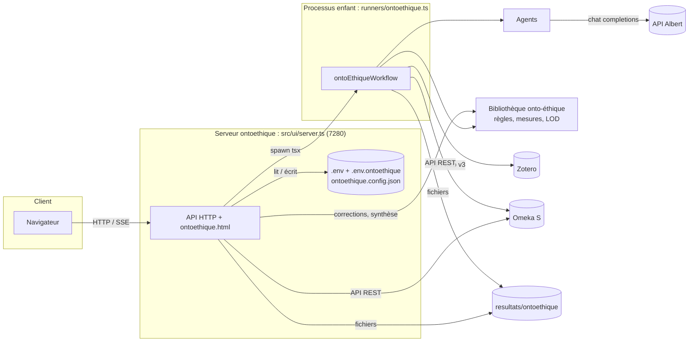
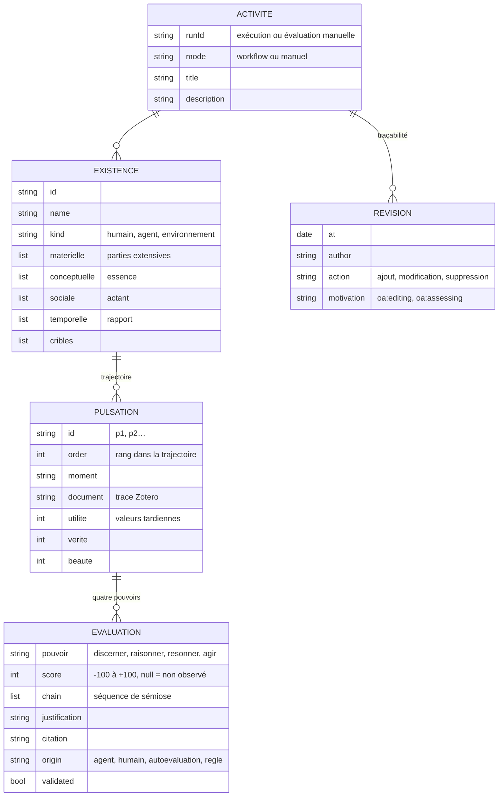
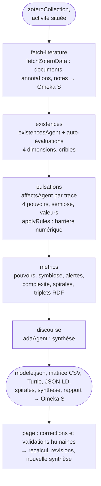

# Documentation technique

Écosystème d'agents IA pour la **modélisation onto-éthique des existences informationnelles** dans un environnement humain-numérique (Laboratoire Paragraphe, Université Paris 8). Le projet est écrit en **TypeScript**, exécuté par **tsx** sous **Node.js 22+**, et orchestré par des workflows **Mastra**. Les modèles de langage sont ceux de l'**API Albert** (compatible OpenAI), les traces viennent de **Zotero** et les résultats sont archivés dans **Omeka S**.

Le socle (connexions, comptage des tokens et coût, onglet Workflow, item de configuration Omeka S, archives, serveur) est repris de l'écosystème `ecosysteme-agents-recherche` ; chaque application y ajoute son workflow, son lanceur, sa page et son serveur :

| Application | Workflow | Lanceur | Page | Serveur | Section |
|---|---|---|---|---|---|
| ontoÉthique | `ontoEthiqueWorkflow` (`src/workflow/ontoethiqueWorkflow.ts`) | `src/runners/ontoethique.ts` | `ontoethique.html` | `ONTOETHIQUE_PORT` 7280 | 12 |

Le cadre théorique et le protocole de mesure sont ceux de l'article « Le tournant ontologique dans les humanités numériques » (S. Szoniecky) : métamodèle à quatre dimensions existentielles, quatre pouvoirs de la pulsation existentielle, grille des affects (-100 à +100), triplets de sémiose, valeurs tardiennes, spirale conique de Pappus.

## 1. Architecture



- **Interface** (`src/ui/server.ts`) : serveur `node:http` sans dépendance, lancé une fois par application, qui gère les connexions et la configuration, lance le workflow dans un **processus enfant** (configuration et connexions relues à chaque exécution), diffuse le journal en **Server-Sent Events** et sert les résultats. Les routes propres à ontoÉthique sont dans `src/ui/ontoethiqueRoutes.ts`.
- **Lanceur** (`src/runners/ontoethique.ts`) : enregistre la configuration dans Omeka S, exécute le workflow, écrit les fichiers de l'évaluation, importe les documents dans l'item de configuration.
- **Bibliothèque** (`src/lib/ontoethique/`) : fonctions pures partagées par le workflow et les routes (règles du métamodèle, mesures, export Linked Open Data) : une correction humaine recalcule exactement ce que calcule le workflow.
- **Paramètres de connexion** : page commune `src/ui/public/settings.html`, servie sur `/parametres` ; elle enregistre les connexions dans `.env.ontoethique` (qui surcharge `.env`).
- **Répertoire de données** : le répertoire courant (racine du projet en local, volume `/data` dans Docker, le code étant dans `/app`).

Règles de passage des données dans Mastra : après un `.then(...)`, l'étape reçoit la sortie de l'étape précédente ; après un `.parallel([...])`, `{ "<id étape>": sortie }` ; `getStepResult("<id>")` donne la sortie d'une étape antérieure. Les outils sont appelés **directement** (`outil.execute({ data })`) : les données brutes ne passent jamais par un modèle.

## 2. Organisation du code

```
src/
├── agents/                   ask.ts (askAgent), overrides.ts (agents.config.json) ; existencesAgent, affectsAgent, adaAgent
├── config/
│   ├── index.ts              socle commun (defaultWorkflowConfig : modèles Albert, Zotero, extraction, coût, termes Omeka S)
│   ├── ontoethique.ts        configuration d'ontoÉthique (defaultOntoEthiqueConfig, ontoEthiqueConfig, RUNS_DIR)
│   ├── models.ts             modèles Albert
│   └── store.ts              fusion avec workflow.config.json / ontoethique.config.json (REPLACED_PATHS)
├── lib/
│   ├── ontoethique/          model (types, règles, auto-évaluations, CSV), metrics (pouvoirs, symbiose, alertes, spirales),
│   │                         linkedData (Turtle, JSON-LD), spiralHtml, prompts (mise en forme, schémas zod),
│   │                         synthesis (ADA), outputs (liste blanche, fichiers dérivés), example (scénarios A et B de l'article)
│   ├── analysis/             annotationPositions (grille de couleurs), codebook (codes des marqueurs), cleanGraph (identifiants)
│   ├── extraction/           pdfExtract, attachmentExtract, zip, chunkText
│   ├── metrics/              usage (tokens), impact (énergie, carbone, argent), usageHistory (onglet Workflow)
│   ├── omeka/                omk (client), oaAnnotations, conceptIndex, zoteroCollections
│   ├── albert/               albert (client de l'API Albert)
│   └── zotero/               zotero (client), zoteroToOmeka, duplicates
├── tools/                    fetchZoteroData (outil Mastra)
├── workflow/
│   ├── ontoethiqueWorkflow.ts
│   ├── steps/common/         fetchLiteratureStep
│   ├── steps/ontoethique/    existencesStep, pulsationsStep, metricsStep, discourseStep
│   ├── reports/              ontoethiqueReport, usageReport (consommation et coût, partagé)
│   ├── runs/                 saveWorkflowConfig (item Omeka), importSynthesis (médias)
│   └── diagrams.ts           AGENTS + DIAGRAMS (onglet Workflow)
├── runners/ontoethique.ts
└── ui/
    ├── server.ts             serveur d'une application (npm run ui:ontoethique)
    ├── ontoethiqueRoutes.ts  routes d'ontoÉthique
    └── public/               ontoethique.html, settings.html, workflowDiagram.js
```

Hors de `src/` : `docs/` (documentation), `scripts/build-docs.ts`, `docker/entrypoint.sh`, `.vscode/launch.json`, `.claude/launch.json` (configurations `ui-ontoethique` et `ui-ontoethique-test`).

### Agents (`src/agents/`)

| Agent | Modèle | Rôle |
|---|---|---|
| `existencesAgent` (Ontologue des existences) | analytique | identifie les existences informationnelles de l'activité (humains, agents numériques, environnement) et décrit leurs quatre dimensions, leurs cribles et les traces où elles apparaissent |
| `affectsAgent` (Évaluateur des affects) | analytique | un appel par trace : pulsations attestées, score des quatre pouvoirs, séquence de sémiose, justification, citation, valeurs tardiennes |
| `adaAgent` (ADA onto-éthique) | analytique | synthèse discursive : diagnostic de symbiose, comparaison des existences, risques, ajustement des cribles, questions pour une éthique de la discussion ; cite les pulsations `[p3]` |

Chaque agent exporte ses instructions (`XXX_INSTRUCTIONS`) et sa demande à variables (`XXX_PROMPT`), passées par `overridable` / `overridableModel` et `agentText` : elles sont modifiables dans l'onglet **Workflow** (`agents.config.json`). Les appels passent par `askAgent` (sortie structurée zod, comptage des tokens, étiquette `(nomAgent)` dans la source).

### Comptage des tokens et coût

Chaque appel à un modèle enregistre sa consommation (`recordUsage`, fait par `askAgent`). `usageSummary()` alimente le rapport, l'item de configuration (`curation:data`) et l'historique `usage.history.jsonl` (estimation du coût dans l'onglet Workflow). `estimateImpact` convertit les tokens en énergie, carbone et argent avec les hypothèses de `costs` (`workflow.config.json`). La nouvelle synthèse demandée depuis la page est comptée de la même façon (tâche `synthese`).

## 3. Modèle onto-éthique

Le modèle d'une évaluation (`OntoModel`, `src/lib/ontoethique/model.ts`, fichier `modele.json`) :



**Règles du métamodèle** (`applyRules`, appliquées après toute évaluation : agents, auto-évaluations, saisie humaine) :

- scores bornés à [-100, 100] et arrondis ;
- **barrière numérique** : pour un genre sans résonance (`kinds[].resonance = false`), Résonner reçoit `rules.noResonanceScore` (0 par défaut ; `null` désactive la règle) avec l'origine `regle` ;
- **souveraineté de l'expertise humaine** (`rules.humanSovereignty`) : une évaluation validée par un humain n'est pas remplacée par la règle ; l'écart est signalé par une alerte « barrière contestée » pour la discussion.

**Auto-évaluations** (`selfEvaluations`) : une annotation ou une note Zotero portant des marqueurs conformes à `selfEvaluation.tagPattern` (`discerner+40`, `agir:-30`, `Résonner=10`…) devient une pulsation de l'actant humain auteur de l'annotation (créé au besoin, `humain-<nom>`), avec l'origine `autoevaluation`, validée d'office.

## 4. Mesure des fluctuations (`src/lib/ontoethique/metrics.ts`)

Sans modèle de langage :

| Indicateur | Calcul |
|---|---|
| Statistiques d'un pouvoir | nombre, moyenne, somme, somme des augmentations et des diminutions, min, max ; **état** de la grille d'après la moyenne (diminution, neutre, augmentation) et son nom (Cécité cognitive, Clarté sémiotique…) |
| Valence, intensité, affect | moyenne des scores, moyenne des écarts à 0 ; joie (> 0,5), tristesse (< -0,5), indifférence |
| Valeurs tardiennes | moyennes de l'utilité, de la vérité, de la beauté |
| Complexité ontologique | entropie normalisée de la répartition des éléments entre les quatre dimensions (1 = dimensions également constituées) × log₂(1 + nombre d'éléments) — proposition d'opérationnalisation |
| Par genre | moyennes des pouvoirs et de la valence des humains, des agents, de l'environnement |
| Symbiose | **indice** = valence moyenne des existences ÷ 100 (de -1 à 1) ; **équilibre** = 1 − écart des valences entre genres ÷ 200 ; interprétation : symbiose mutuellement profitable, croissance déséquilibrée, indifférence, diminution des puissances |
| Alertes | misère symbolique (humain dont Raisonner et Résonner ≤ `lowThreshold` alors qu'un agent agit ≥ `highThreshold`), cécité cognitive, aliénation logique (agents), indignation (valeur-vérité ≤ `indignationThreshold`), geste blanc, barrière contestée, déséquilibre entre genres |

**Spirale conique de Pappus** : pour chaque existence, les pulsations sont parcourues dans l'ordre de sa trajectoire ; le **rayon** croît des augmentations de Résonner (dilatation rhizomatique), l'**altitude** de celles d'Agir, l'**angle** tourne de Discerner + Raisonner (déplacement topographique, `spiral.pointsPerTurn` points par tour, sens inverse si la somme est négative). `spiral.stepsPerPulsation` points sont interpolés entre deux pulsations. Forme : *cône évasé* (rayon / altitude > `flaredRatio`), *flèche* (< `slenderRatio`), *tube* (la seconde moitié de la trajectoire gagne de l'altitude sans s'élargir, `tubeGrowth`), sinon *cône équilibré* ; *disque* sans altitude, *point* sans augmentation.

## 5. Export Linked Open Data (`src/lib/ontoethique/linkedData.ts`)

Les mêmes triplets sont écrits en **Turtle** (`modele_onto_ethique.ttl`) et en **JSON-LD** (`modele_onto_ethique.jsonld`). Vocabulaire `oe:` (`ontology.baseUri`), individus sous `ontology.dataUri` + identifiant d'évaluation.

| Terme | Usage |
|---|---|
| `oe:ActiviteSituee` (+ `prov:Activity`) | l'activité : `dcterms:title`, `dcterms:description`, `oe:indiceSymbiose`, `oe:equilibreSymbiose` |
| `oe:ActantHumain`, `oe:AgentNumerique`, `oe:EnvironnementDocumentaire` | existences : `rdfs:label`, `oe:genre`, `oe:participeA`, `oe:dimensionMaterielle` / `Conceptuelle` / `Sociale` / `Temporelle`, `oe:crible`, `oe:valence`, `oe:complexiteOntologique`, `oe:formeSpirale` |
| `oe:Pulsation` | `oe:existence`, `oe:ordre`, `rdfs:label` (moment), `dcterms:source` / `dcterms:references` (trace Zotero), `oe:valeurUtilite` / `Verite` / `Beaute`, `prov:wasGeneratedBy` |
| `oe:Evaluation` | `oe:pouvoir` (`oe:Discerner`…), `oe:score`, `oe:semiose`, `rdfs:comment`, `oa:exact` (citation), `oe:origine`, `oe:validee` |
| `oa:Annotation` | révisions humaines : `oa:motivatedBy` (`oa:editing`, `oa:assessing`), `oa:hasTarget`, `dcterms:creator`, `oa:bodyValue` |

## 6. Modèle de données Omeka S

Le workflow écrit dans le modèle commun de l'écosystème : la collection Zotero (`bibo:Collection`), ses documents et leurs `oa:Annotation` (étape `fetch-literature`), et un **item de configuration** par exécution (`dcterms:MethodOfInstruction`, `dcterms:type` « Configuration de workflow », `dcterms:identifier` = identifiant d'exécution, `dcterms:description` = configuration JSON avec `workflowId: onto-ethique`, `curation:status`, `curation:data` = tokens et coût). Les fichiers de l'évaluation y sont déposés comme médias (`dcterms:identifier` = `<runId>/<fichier>`). Une évaluation manuelle reçoit son item de configuration au premier « Enregistrer dans Omeka S » ; un nouvel enregistrement dépose les fichiers corrigés et retire les anciens médias de même nom.

## 7. Configuration

| | ontoÉthique |
|---|---|
| Défauts | `src/config/ontoethique.ts` (`defaultOntoEthiqueConfig`) ; socle : `src/config/index.ts` |
| Surcharges | `ontoethique.config.json` (`ONTOETHIQUE_CONFIG_FILE`) ; socle : `workflow.config.json` |
| Configuration effective | `ontoEthiqueConfig` ; socle : `workflowConfig` |

Les modifications faites dans l'interface sont enregistrées dans le fichier de surcharges (seules les différences). Les tableaux sont remplacés en bloc ; les chemins `kappa.codes`, `annotationPositions`, `omeka.vocabs` et `costs.models` aussi (`REPLACED_PATHS`).

| Clé | Rôle |
|---|---|
| `workflowId` | `onto-ethique` : titre et repérage des items de configuration |
| `input.zoteroCollection` | collection des traces de l'activité |
| `activity.title`, `activity.description` | activité située évaluée |
| `models.analytics`, `models.fast` | modèles Albert (rôles analytique et rapide de l'onglet Workflow) |
| `analysis.mergeDuplicates` | fusion des documents en double |
| `analysis.maxDocuments`, `maxCharsPerDocument`, `existencesCharsPerDocument`, `maxAnnotationsPerDocument`, `maxExistences`, `concurrency` | traces évaluées, taille des extraits (évaluateur, ontologue), annotations transmises, existences, appels simultanés |
| `kinds` | genres d'existences (`id`, `label`, `resonance`) |
| `dimensions` | métamodèle : `id`, `label`, `spinoza`, `metric`, `pretopology`, `analogy`, `instruction` |
| `powers` | grille des affects : `id` (identifiants fixes : `discerner`, `raisonner`, `resonner`, `agir`), `label`, `semiosis`, `chain`, états `negative` / `neutral` / `positive` |
| `values` | valeurs tardiennes (`utilite`, `verite`, `beaute`) et force (Désir, Croyance) |
| `rules.noResonanceScore`, `rules.humanSovereignty` | barrière numérique, souveraineté de l'expertise humaine |
| `selfEvaluation.enabled`, `selfEvaluation.tagPattern` | auto-évaluations par marqueurs Zotero |
| `symbiosis.lowThreshold`, `highThreshold`, `indignationThreshold` | seuils des alertes |
| `spiral.pointsPerTurn`, `stepsPerPulsation`, `flaredRatio`, `slenderRatio`, `tubeGrowth` | géométrie et formes de la spirale |
| `discourse.maxPulsations` | pulsations transmises à l'ADA |
| `ontology.baseUri`, `ontology.dataUri` | espaces de noms de l'export LOD |
| `outputDir` | `resultats/ontoethique` |

Socle (`workflow.config.json`) : `models.provider`, `zotero.automaticTags`, `extraction.*`, `annotationPositions`, `costs.*` (devise, électricité, carbone, matériel, tarifs par modèle), `omeka.*` (vocabulaires, classes, propriétés).

## 8. API de l'interface

Routes communes :

| Méthode et route | Rôle |
|---|---|
| `GET /` | page de l'application |
| `GET /parametres` | page des connexions (`settings.html`) |
| `GET`, `POST /api/settings` | connexions (secrets masqués, valeurs héritées signalées) et configuration de l'application |
| `POST /api/check` | teste Albert, Zotero et Omeka S |
| `GET`, `POST /api/zotero/collections` | collections de la bibliothèque enregistrée ou en cours de saisie |
| `GET /api/albert/models` | modèles disponibles |
| `GET /api/workflow`, `POST /api/workflow/agent` | diagramme, agents, coût estimé ; textes et modèle d'un agent |
| `GET /api/apps` | application du serveur et adresses des applications |
| `POST /api/run`, `POST /api/run/stop`, `GET /api/run`, `GET /api/run/events` | lancer, arrêter, état, journal (SSE) |
| `GET /docs/…` | documentation HTML |

Routes propres à ontoÉthique (`src/ui/ontoethiqueRoutes.ts`, 404 sur un autre serveur). Les identifiants d'évaluation sont validés (`[\w-]{1,80}`) et seuls les fichiers de la liste `ONTO_FILES` sont servis :

| Méthode et route | Rôle |
|---|---|
| `GET`, `POST /api/ontoethique/settings` | configuration de l'application |
| `GET /api/ontoethique/runs` | évaluations : archive locale (`resultats/ontoethique/analyses/<run>/analyse.json`) et items de configuration Omeka S (`workflowId = onto-ethique`) |
| `GET /api/ontoethique/results?run=` | fichiers d'une évaluation (archive locale, sinon médias Omeka S) |
| `GET /api/ontoethique/file?run=&name=&raw=` | contenu d'un fichier (`raw=1` : page HTML telle quelle) |
| `GET /api/ontoethique/model?run=` | modèle (`modele.json`) |
| `POST /api/ontoethique/manual` | `{ title, description }` ou `{ example: true }` : évaluation manuelle (identifiant `manuel-<date>-<aléa>`) |
| `POST /api/ontoethique/activity` | `{ run, activity }` |
| `POST /api/ontoethique/pulsation` | `{ run, pulsation, author?, note?, motivation? }` : ajout (identifiant attribué) ou modification |
| `POST /api/ontoethique/pulsation/delete` | `{ run, id }` |
| `POST /api/ontoethique/existence` | `{ run, existence }` : ajout ou modification |
| `POST /api/ontoethique/existence/delete` | `{ run, id }` : l'existence et ses pulsations |
| `POST /api/ontoethique/synthesis` | `{ run }` : nouvelle synthèse de l'ADA à partir du modèle corrigé, avec son coût |
| `POST /api/ontoethique/omeka` | `{ run }` : dépôt des fichiers dans l'item de configuration (créé pour une évaluation manuelle) |
| `POST /api/ontoethique/runs/delete` | `{ runId, omeka }` : Omeka S d'abord, puis archive locale |

Chaque modification charge le modèle (recopié depuis Omeka S s'il n'existe que là), l'applique, ajoute une **révision**, puis `writeModelFiles` réapplique les règles, recalcule les indicateurs et réécrit `modele.json`, `matrice_affects.csv`, le Turtle, le JSON-LD et les spirales ; la réponse est le modèle à jour.

## 9. Étendre le projet

- **Ajouter une application** : skill `nouvelle-application` (`.claude/skills/`) : configuration, étapes, workflow, agents, lanceur, rapport, entrée `APPS` du serveur, routes, page, `package.json`, `.claude/launch.json`, `.vscode/launch.json`, Docker, documentation.
- **Ajouter ou modifier un agent** : skill `agent-albert`. **Brancher une API** : skill `connecteur-api`. **Enregistrer dans Omeka S** : skill `persistance-omeka`.
- **Ajouter un pouvoir, une dimension, un genre** : les tableaux `powers`, `dimensions`, `kinds` de la configuration ; les schémas des agents, l'export LOD et la page s'y adaptent. La spirale utilise les identifiants `discerner`, `raisonner`, `resonner`, `agir`.

## 10. Documentation et conteneur

- `npm run docs` convertit `docs/*.md` en `docs/html/*.html` (servi sur `/docs/`).
- `Dockerfile` : image `node:22-bookworm-slim`, code dans `/app`, données dans le volume `/data` ; commandes `workflow-ui` (serveur de l'application `WORKFLOW_APP`) et `workflow-ontoethique` (ligne de commande).
- `docker-compose.yml` : service `ontoethique` (7280, publié sur `127.0.0.1`), volume `./data:/data`, `host.docker.internal` pour un Omeka S local.
- `.vscode/launch.json` : débogage du workflow, du serveur sur 7290 (avec le processus enfant) et du fichier courant.

## 11. Limites connues

- `tsc --noEmit` signale des erreurs liées à la configuration TypeScript (CommonJS avec `verbatimModuleSyntax`) et aux types Mastra (étapes sans schéma) ; l'exécution par tsx n'est pas affectée.
- Les scores proposés par les agents sont des hypothèses de lecture : la matrice est faite pour être corrigée et validée par les participants (onglet Matrice) ; la synthèse distingue les évaluations validées.
- La complexité ontologique, l'indice de symbiose et la géométrie de la spirale sont des opérationnalisations proposées du métamodèle, réglables dans la configuration.
- Seuls les fichiers de l'évaluation sont déposés dans Omeka S : les existences et pulsations n'y sont pas des items (elles sont dans le JSON-LD et le Turtle).
- Les extensions `ttl`, `jsonld`, `csv`, `md`, `html` et `json` doivent être autorisées dans Omeka S (sinon dépôt en `.txt`).

## 12. Workflow ontoÉthique



| Élément | Rôle |
|---|---|
| `fetch-literature` | étape commune : collection, annotations (auteur, couleur, date, marqueurs), notes, enregistrement dans Omeka S ; `mergeDuplicates` selon `analysis.mergeDuplicates` |
| `existences` (`existencesStep.ts`) | documents retenus (`selectDocuments` : texte ou annotations, `maxDocuments`) ; auto-évaluations ; un appel à l'ontologue avec tous les documents (`existencesCharsPerDocument`) ; genres normalisés ; participants auto-évalués fusionnés par identifiant ou nom ; échec si aucune existence |
| `pulsations` (`pulsationsStep.ts`) | un appel à l'évaluateur par document (`concurrency` simultanés) ; existence résolue par identifiant ou nom ; scores `null` écartés ; auto-évaluations placées avant les pulsations de l'agent pour chaque document ; numérotation `p1…`, rangs par existence ; `applyRules` |
| `metrics` (`metricsStep.ts`) | `computeMetrics` et nombre de triplets RDF |
| `discourse` (`discourseStep.ts`) | `adaSynthesis` ; non bloquante (avertissement si Albert est indisponible) |
| `src/runners/ontoethique.ts` | refus sans collection ; item de configuration ; exécution ; `writeModelFiles` dans `resultats/ontoethique/analyses/<runId>/` (+ copie à la racine de `outputDir`) ; `synthese_ada.md`, `rapport_ontoethique.md`, `analyse.json` ; coût ; statut et médias Omeka S |

Fichiers d'une évaluation : `modele.json`, `matrice_affects.csv`, `modele_onto_ethique.ttl`, `modele_onto_ethique.jsonld`, `spirales_pappus.html` (page autonome Plotly), `synthese_ada.md`, `rapport_ontoethique.md` (exécutions du workflow), `analyse.json` (description : mode, statut, dates, activité, collection, item de configuration, tokens, coût, totaux, symbiose, configuration).

### Un serveur par application

| | ontoÉthique (`ontoethique`) |
|---|---|
| Lancement | `npm run ui:ontoethique` (ou `npm run ui`) |
| Port / adresse d'écoute | `ONTOETHIQUE_PORT` (7280) / `ONTOETHIQUE_HOST` (ou `HOST`) |
| Connexions | `.env` surchargé par `.env.ontoethique` (`ONTOETHIQUE_ENV_FILE`) |
| Configuration | `ontoethique.config.json` (+ `workflow.config.json` pour le socle) |
| Workflow lancé | `src/runners/ontoethique.ts` |
| Page | `ontoethique.html` |
